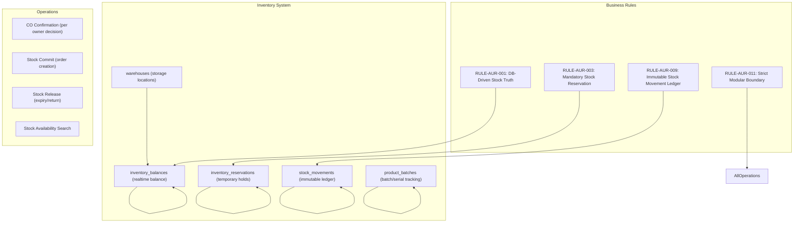

---
id: DOC-AUR-162
title: Aura Bell — Inventory System Architecture Specification
type: database
status: confirmed
version: 2.0
language: Bangla with English technical terms
source: AB-DS-001, AB-PV-001
last_updated: 2026-11-08
---

# Aura Bell — Inventory System Architecture (ইনভেন্টরি সিস্টেম আর্কিটেকচার)

## 1. Overview

This document specifies the inventory system architecture for the Aura Bell e-commerce platform. The inventory system manages stock availability, reservations, movements, and tracking across multiple stores with zero over-selling guarantee.

**Status**: Specified (Documented, not implemented)

**Related Documents**:
- `03_PRODUCT_REQUIREMENTS/INVENTORY_PRD.md` (DOC-AUR-045)
- `05_DATABASE/DATABASE_SCHEMA.md` (DOC-AUR-070)
- `04_SYSTEM_ARCHITECTURE/MODULE_ARCHITECTURE.md` (DOC-AUR-061)
- `02_BUSINESS_REQUIREMENTS/BUSINESS_RULES.md` (RULE-AUR-001, RULE-AUR-003, RULE-AUR-009)
- `04_SYSTEM_ARCHITECTURE/ARCHITECTURE_DECISION_RECORDS.md` (ADR-006, ADR-007, ADR-010)

---

## 2. Inventory Architecture Design

### 2.1 Core Inventory Components

The inventory system consists of the following core components:



### 2.2 Inventory Module Architecture

The inventory module is part of the 11-module backend architecture (ADR-007: Split Order Architecture):

```
app/modules/inventory/
├── __init__.py
├── services/
│   ├── balance_service.py      # inventory_balances operations
│   ├── reservation_service.py  # inventory_reservations operations
│   ├── movement_service.py     # stock_movements operations
│   └── batch_service.py        # product_batches operations
├── models/
│   ├── inventory_balance.py    # inventory_balances model
│   ├── inventory_reservation.py # inventory_reservations model
│   ├── stock_movement.py       # stock_movements model
│   └── product_batch.py        # product_batches model
└── schemas/
    ├── balance_schema.py       # API schemas
    ├── reservation_schema.py   # API schemas
    ├── movement_schema.py      # API schemas
    └── batch_schema.py         # API schemas
```

### 2.3 Module Dependencies

| Module | Depends On | Relationship |
|--------|------------|--------------|
| Identity Module | User IDs, customer profiles | Reference |
| Store Module | Store-specific inventory settings | Reference |
| Catalog Module | Product IDs, batch/serial numbers | Reference |
| Order Module | Stock reservations, order creation | Customer |
| Payment Module | Stock release on payment failure | Integration |
| Shipping Module | Stock status for shipment | Integration |

---

## 3. Inventory Tables Specification

### 3.1 Table: `inventory_balances`

| Field | Type | Description | Constraints |
|-------|------|-------------|-------------|
| `balance_id` | UUID | Primary key | PRIMARY KEY |
| `product_variant_id` | UUID | FK to product_variants | FK, NOT NULL |
| `warehouse_id` | UUID | FK to warehouses | FK, NOT NULL |
| `quantity_on_hand` | Integer | Current stock quantity | CHECK ≥ 0 |
| `quantity_reserved` | Integer | Reserved for orders | CHECK ≥ 0, DEFAULT 0 |
| `quantity_available` | Integer | On hand minus reserved | COMPUTED |
| `last_verified_at` | Timestamp | Last stock count verification | NOT NULL |
| `updated_at` | Timestamp | Last update | NOT NULL |

### 3.2 Table: `inventory_reservations`

| Field | Type | Description | Constraints |
|-------|------|-------------|-------------|
| `reservation_id` | UUID | PRIMARY KEY | PRIMARY KEY |
| `order_id` | UUID | FK to orders | FK, NOT NULL |
| `product_variant_id` | UUID | FK to product_variants | FK, NOT NULL |
| `quantity_reserved` | Integer | Quantity reserved | CHECK > 0 |
| `reserved_at` | Timestamp | When reserved | NOT NULL |
| `expires_at` | Timestamp | TTL expiration (15 minutes — DEC-OWN-002 (CONFIRMED — 15 minutes) CONFIRMED) | NOT NULL |
| `released_at` | Timestamp | When released | NULL = active |
| `release_reason` | Text | Reason for release | NULL = active |

### 3.3 Table: `stock_movements`

| Field | Type | Description | Constraints |
|-------|------|-------------|-------------|
| `movement_id` | UUID | PRIMARY KEY | PRIMARY KEY |
| `product_variant_id` | UUID | FK to product_variants | FK, NOT NULL |
| `warehouse_id` | UUID | FK to warehouses | FK, NOT NULL |
| `movement_type` | Enum | IN, OUT, RESERVATION, RELEASE | CHECK required |
| `quantity` | Integer | Quantity changed | CHECK ≠ 0 |
| `related_order_id` | UUID | FK to orders (if applicable) | FK, NULL |
| `related_reservation_id` | UUID | FK to reservations | FK, NULL |
| `movement_at` | Timestamp | When movement occurred | NOT NULL |
| `reference_id` | UUID | Order/reservation reference | NULLable |
| `notes` | Text | Additional notes | NULLable |

### 3.4 Table: `product_batches`

| Field | Type | Description | Constraints |
|-------|------|-------------|-------------|
| `batch_id` | UUID | PRIMARY KEY | PRIMARY KEY |
| `product_variant_id` | UUID | FK to product_variants | FK, NOT NULL |
| `batch_number` | String | Batch identifier | UNIQUE, NOT NULL |
| `product_type` | Enum | gasket/skincare | CHECK required |
| `manufacturing_date` | DATE | Production date | NOT NULL |
| `expiry_date` | DATE | Expiration date | NOT NULL |
| `current_stock` | Integer | Current batch stock | CHECK ≥ 0 |
| `is_active` | Boolean | Batch active status | DEFAULT TRUE |

### 3.5 Table: `product_serials`

| Field | Type | Description | Constraints |
|-------|------|-------------|-------------|
| `serial_id` | UUID | PRIMARY KEY | PRIMARY KEY |
| `product_variant_id` | UUID | FK to product_variants | FK, NOT NULL |
| `serial_number` | String | Unique serial/IEM | UNIQUE, NOT NULL |
| `product_type` | Enum | gasket/skincare | CHECK required |
| `manufacturing_date` | DATE | Production date | NOT NULL |
| `activation_date` | DATE | When activated in system | NULL = new |
| `deactivation_date` | DATE | When deactivated | NULL = active |
| `status` | Enum | active/reserved/sold/returned | DEFAULT active |

### 3.6 Table: `warehouses`

| Field | Type | Description | Constraints |
|-------|------|-------------|-------------|
| `warehouse_id` | UUID | PRIMARY KEY | PRIMARY KEY |
| `warehouse_code` | String | Warehouse code | UNIQUE, NOT NULL |
| `warehouse_name` | String | Warehouse name | NOT NULL |
| `location` | Text | Physical location | NULLable |
| `is_active` | Boolean | Active status | DEFAULT TRUE |
| `capacity` | Integer | Maximum capacity | CHECK ≥ 0 |

### 3.7 Table: `reservation_ttl_config`

| Field | Type | Description | Constraints |
|-------|------|-------------|-------------|
| `config_id` | UUID | PRIMARY KEY | PRIMARY KEY |
| `ttl_minutes` | Integer | Timeout period in minutes | CHECK > 0 |
| `provider_decision` | String | DEC-OWN-002 (CONFIRMED — 15 minutes) value | NOT NULL |
| `is_active` | Boolean | Config active | DEFAULT TRUE |
| `created_at` | Timestamp | When created | NOT NULL |
| `updated_at` | Timestamp | When updated | NOT NULL |

---

## 4. Inventory Operations

### 4.1 Stock Availability Search

```
Stock Availability Search Algorithm:
1. Input: product_variant_id, warehouse_id?, quantity_required
2. Query inventory_balances table
3. Check:
   - quantity_on_hand ≥ quantity_required
   - quantity_available ≥ quantity_required
4. Return availability status and details
5. If insufficient stock → Return error with current levels
```

### 4.2 Stock Reservation Process

```
Stock Reservation Process:
1. Input: order_id, product_variant_id(s), quantity, customer_id
2. Check availability (Step 4.1)
3. If sufficient stock:
   a. Decrement quantity_available in inventory_balances
   b. Increment quantity_reserved in inventory_balances
   c. Create reservation record in inventory_reservations
      - reservation_id
      - order_id
      - product_variant_id
      - quantity_reserved
      - reserved_at = NOW()
      - expires_at = NOW() + TTL (15 minutes — DEC-OWN-002 (CONFIRMED — 15 minutes) CONFIRMED)
   d. Create stock_movement record
      - movement_type = RESERVATION
      - quantity = reserved_quantity
      - related_order_id = order_id
   e. Return reservation confirmation with expires_at
5. If insufficient stock:
   - Return insufficient stock error
   - No state changes
```

### 4.3 Stock Release Process

```
Stock Release Process:
1. Input: reservation_id OR expires_at check
2. Identify reservations expiring or manually released
3. For each expiring reservation:
   a. Decrement quantity_reserved in inventory_balances
   b. Increment quantity_available in inventory_balances
   c. Update reservation.released_at
   d. Set reservation.release_reason = "TTL_EXPIRY" or "MANUAL"
   e. Create stock_movement record
      - movement_type = RELEASE
      - quantity = reserved_quantity
      - related_reservation_id = reservation_id
4. For manual release:
   a. Same steps as above but with different reason
5. Return release confirmation
```

### 4.4 Stock Release on Payment Failure

```
Payment Failure Stock Release Workflow:
1. Payment attempt fails (3 attempts max per confirmed business decision)
2. System checks inventory_reservations for affected order
3. If reservations exist and expired (TTL DEC-OWN-002 (CONFIRMED — 15 minutes)):
   - Release reservations (Step 4.3)
   - Restore stock to available inventory
   - Notify customer of payment failure
   - Mark order as payment failed
4. If reservations exist but not expired:
   - Keep reservations active
   - Wait for TTL expiry or manual release
   - Continue monitoring
5. If no reservations:
   - Order proceeds to cancellation workflow
```

---

## 5. Stock Movement Types

### 5.1 Movement Type Specification

| Movement Type | Description | When Triggered | Database Impact |
|---------------|-------------|----------------|-----------------|
| `IN` | Stock increase (receipt, restock) | Admin restock, return processing | inventory_balances.quantity_on_hand + |
| `OUT` | Stock decrease (sale, adjustment) | Order completion, admin adjustment | inventory_balances.quantity_on_hand - |
| `RESERVATION` | Stock reservation for order | Order creation with stock hold | inventory_balances.quantity_reserved + |
| `RELEASE` | Stock release (expiry, return) | Reservation expiry, order cancellation | inventory_balances.quantity_reserved - |
| `SALE` | Sale completion | Order finalization after payment | inventory_balances.quantity_reserved - (convert to on_hand) |
| `RETURN` | Stock return (customer return) | Customer returns order | inventory_balances.quantity_on_hand + |

### 5.2 Movement Validation Rules

| Validation | Requirement |
|------------|-------------|
| Movement quantity ≠ 0 | Required |
| Cannot reserve more than available | Required |
| Reservation must have TTL | Required (DEC-OWN-002 (CONFIRMED — 15 minutes)) |
| Movements must be immutable | Required (RULE-AUR-009) |
| Related entities must exist | Required (FK constraints) |

---

## 6. Batch and Serial Number Tracking

### 6.1 Skincare Products (Batch Tracking)

For Aura Skin Care products, batch tracking is mandatory:

| Requirement | Description |
|-------------|-------------|
| Batch number mandatory | For each skincare product variant |
| Manufacturing date tracking | Required per batch |
| Expiry date tracking | Required per batch |
| Current stock per batch | Tracked in product_batches table |
| Batch-level serialization | Optional but recommended |

**Batch Operations**:
- Create batch with manufacturing/expiry dates
- Decrement batch stock on sale
- Check expiry before sale
- Auto-expire batches on expiry date
- Track batch-level serial numbers if needed

### 6.2 Gadget Products (IMEI/Serial Tracking)

For Best Gadget products, IMEI/serial number tracking is mandatory:

| Requirement | Description |
|-------------|-------------|
| Unique serial number per unit | Mandatory |
| IMEI tracking for mobile devices | Mandatory |
| Serial number in product_serials table | Required |
| Activation tracking | When device activated in system |
| Status tracking | active/reserved/sold/returned |

**Serial Operations**:
- Generate unique serial number per gadget unit
- Track in product_serials table
- Check activation status before sale
- Mark as reserved during order creation
- Update status on order completion

### 6.3 Batch and Serial Integration

```
Integration Logic:
1. Product type determines tracking method
2. Skincare → batch tracking (product_batches)
3. Gadgets → serial tracking (product_serials)
4. Combined products → Both methods
5. Stock operations respect tracking method
6. Reports generated per tracking method
```

---

## 7. COD Confirmation Process

### 7.1 COD (Cash on Delivery) Confirmation

**Confirmed Owner Decision**: COD Confirmation is Required (from mission requirements).

| Step | Action | Responsible | Notes |
|------|--------|-------------|-------|
| 1 | Customer selects COD at checkout | Customer | Order created with payment_status = 'cod_pending' |
| 2 | Order created with stock reservation | System | RULE-AUR-003 (Mandatory Stock Reservation) |
| 3 | Delivery executed | Admin/Delivery person | Physical delivery |
| 4 | Customer pays cash on delivery | Customer | Payment collected |
| 5 | COD confirmation recorded | Admin | Payment status updated to 'cod_confirmed' |
| 6 | Stock reservation finalized | System | Reservation converted to sale |
| 7 | Customer notified | System | Order status update notification |

### 7.2 COD Confirmation Rules

| Rule | Description | Enforcement |
|------|-------------|-------------|
| COD pending → confirmed within TTL | Required | DEC-OWN-002 (CONFIRMED — 15 minutes) CONFIRMED (15 minutes) |
| Stock reservation auto-release after TTL | Required | DEC-OWN-002 (CONFIRMED — 15 minutes) CONFIRMED (15 minutes) |
| Manual admin override possible | Allowed | Admin panel |
| Stock reservation mandatory before COD | Required | RULE-AUR-003 |

### 7.3 COD Failure Handling

| Scenario | Action | Owner Decision |
|----------|--------|----------------|
| COD not confirmed within TTL | Release reservation, mark order failed | DEC-OWN-002 (CONFIRMED — 15 minutes) |
| Customer refuses delivery | Release reservation, restock | DEC-OWN-002 (CONFIRMED — 15 minutes) |
| Partial payment received | Process refund, adjust inventory | DEC-OWN-002 (CONFIRMED — 15 minutes) |

---

## 8. Order State Machine Integration

### 8.1 Inventory State Machine

```
Inventory State → Order State Mapping:

inventory_reservations.status → orders.status
-------------------------------------------
reserved → pending → confirmed → processing → completed/cancelled

On order creation:
1. Reserve stock (inventory_reservations created)
2. Set reservation expires_at (DEC-OWN-002 (CONFIRMED — 15 minutes))
3. Order starts in 'pending' state
4. On payment success → Move to 'confirmed' → 'processing' → 'completed'
5. On payment failure → Release reservation → Move to 'cancelled'

On order cancellation:
1. Release all reservations for order
2. Restore stock to available
3. Update inventory_balances
4. Create stock_movement records
5. Notify customer
```

### 8.2 State Transition Rules

| From State | To State | Condition | Inventory Action |
|------------|----------|-----------|-----------------|
| pending | confirmed | Payment confirmed | Reserve stock (if not already) |
| confirmed | processing | Order fulfilled | Hold reservation |
| processing | completed | Order delivered | Release reservation |
| processing | cancelled | Order cancelled | Release reservation, restore stock |
| confirmed | cancelled | Order cancelled before payment | Release reservation, restore stock |

---

## 9. Cancellation Rules

### 9.1 Order Cancellation Rules

| Cancellation Type | When Allowed | Stock Action | Refund Action | Notes |
|-------------------|--------------|--------------|---------------|-------|
| Customer-initiated | Before payment confirmed | Release reservations | Full refund if within 7-day window | Confirmed Owner Decision (7-day return window) |
| Admin-initiated | Any time before delivery | Release reservations | Restock, no refund if past window | Confirmed Owner Decision (7-day return window) |
| Payment failure | After 3 failed attempts | Release reservations | Full refund | Confirmed Owner Decision (3 attempts max) |
| Admin cancellation | Before shipment | Release reservations | Restock, investigate | RULE-AUR-007 (Store-Specific Return Policies) |

### 9.2 Cancellation Workflow

```
Customer-Initiated Cancellation:
1. Customer requests cancellation in order details
2. System checks:
   - Order status (pending/confirmed allowed)
   - Payment status (not yet paid allowed)
   - 7-day return window (if applicable) [Confirmed Owner Decision]
3. If eligible:
   a. Release all inventory_reservations for order
   b. Restore quantity to inventory_balances (available)
   c. Create stock_movement records (RETURN type)
   d. Update order status to 'cancelled'
   e. Notify customer
4. If not eligible:
   a. Inform customer of ineligibility
   b. Suggest return instead (7-day window) [Confirmed Owner Decision]
   c. Do not modify inventory state
```

---

## 10. V1 vs Future Classification

### 9.1 V1 Inventory Features (Valid for V1)

**V1 Inventory Features Included**:
1. Zero over-selling guarantee (RULE-AUR-001)
2. Mandatory stock reservation before order (RULE-AUR-003)
3. Immutable stock movement ledger (RULE-AUR-009)
4. Stock availability search (REALTIME balance check)
5. Reservation expiry (DEC-OWN-002 (CONFIRMED — 15 minutes) CONFIRMED (15 minutes))
6. COD confirmation workflow (Owner confirmed)
7. Batch tracking for skincare products
8. Serial number tracking for gadgets
9. Order cancellation with stock restoration
10. Reservation TTL expiry release

**V1 Inventory Features Excluded**:
1. Advanced batch analytics
2. Serial number advanced tracking
3. Multi-warehouse routing
4. Automated restocking
5. Inventory forecasting
6. Real-time stock across channels (V1 single DB)

### 9.2 Future (Post-V1) Inventory Features

**Planned Inventory Enhancements**:
1. Multi-warehouse support
2. Inventory forecasting and demand planning
3. Real-time stock across multiple databases
4. Automated restocking triggers
5. Advanced analytics and reporting
6. Channel inventory sync (marketplaces)
7. Damaged/lost stock tracking
8. Quality control integration

---

## 10. Implementation Dependencies

### 9.1 Blocking Dependencies

| Dependency | Status | Impact |
|------------|--------|--------|
| DEC-OWN-002 (CONFIRMED — 15 minutes) (Stock Reservation TTL) | Pending | TTL expiry logic finalized (15 minutes) |
| Database migration execution | Not executed | Cannot create inventory tables |
| Reservation service implementation | Blocked | Cannot process reservations |

### 9.2 Implementation Prerequisites

1. Owner approval for DEC-OWN-002 (CONFIRMED — 15 minutes) (stock reservation TTL)
2. Database migration executed creating inventory tables
3. Reservation service implemented (FastAPI)
4. Stock availability API endpoints
5. Stock commitment/decommitment logic
6. Movement tracking implementation
7. Batch/serial number integration
8. COD confirmation workflow
9. Cancellation workflow implementation

---

## 10. Acceptance Criteria

### 10.1 Inventory Acceptance

- [ ] inventory_balances table created and functional
- [ ] inventory_reservations table created and functional
- [ ] stock_movements table created and functional
- [ ] product_batches table created and functional
- [ ] product_serials table created and functional
- [ ] warehouse table created and functional

### 10.2 Functional Acceptance

- [ ] Stock availability search works
- [ ] Stock reservation creates reservations
- [ ] Stock release expires reservations
- [ ] COD confirmation workflow works
- [ ] Cancellation restores stock
- [ ] Batch tracking for skincare works
- [ ] Serial tracking for gadgets works

### 10.2 Non-Functional Acceptance

- [ ] Reservations released on TTL expiry
- [ ] No over-selling (integrity constraint)
- [ ] All movements logged immutably
- [ ] COD confirmation within TTL
- [ ] Cancellation restores stock within 2 seconds

---

## 11. Final Notes

### 11.1 Mission Compliance
This document satisfies the mission requirement to:
- ✅ Document Inventory System Architecture
- ✅ Document Cart/Checkout stock handling
- ✅ Document Stock Reservation with TTL
- ✅ Document Stock Movement Ledger
- ✅ Document Batch/IMEI/Serial tracking
- ✅ Document COD Confirmation
- ✅ Document Order State Machine
- ✅ Document Cancellation Rules

### 11.2 Critical Blockers
- Inventory implementation blocked by DEC-OWN-002 (CONFIRMED — 15 minutes) (Stock Reservation TTL)
- Inventory tables cannot be finalized without TTL decision
- COD confirmation workflow ready (15 minutes TTL) (CONFIRMED — 15 minutes)

### 11.3 Next Actions
1. Owner completes DEC-OWN-002 (CONFIRMED — 15 minutes) decision (TTL: 10/15/30 minutes)
2. Database migration executed with inventory tables
3. Reservation service implemented
4. Stock commitment/decommitment logic
5. Batch/serial integration
6. COD confirmation workflow

---

**Document ID**: DOC-AUR-162  
**Title**: Aura Bell — Inventory System Architecture Specification  
**Version**: 1.0  
**Status**: Specified  
**Implementation Status**: Not Implemented  
**Last Updated**: 2026-11-08  
**Governance**: Aura Bell Documentation System  
**Compliance**: Mission Requirements - Inventory System  
**V1 Classification**: Pending DEC-OWN-002 (CONFIRMED — 15 minutes) approval  
**Blocking**: DEC-OWN-002 (CONFIRMED — 15 minutes) (Stock Reservation TTL)
