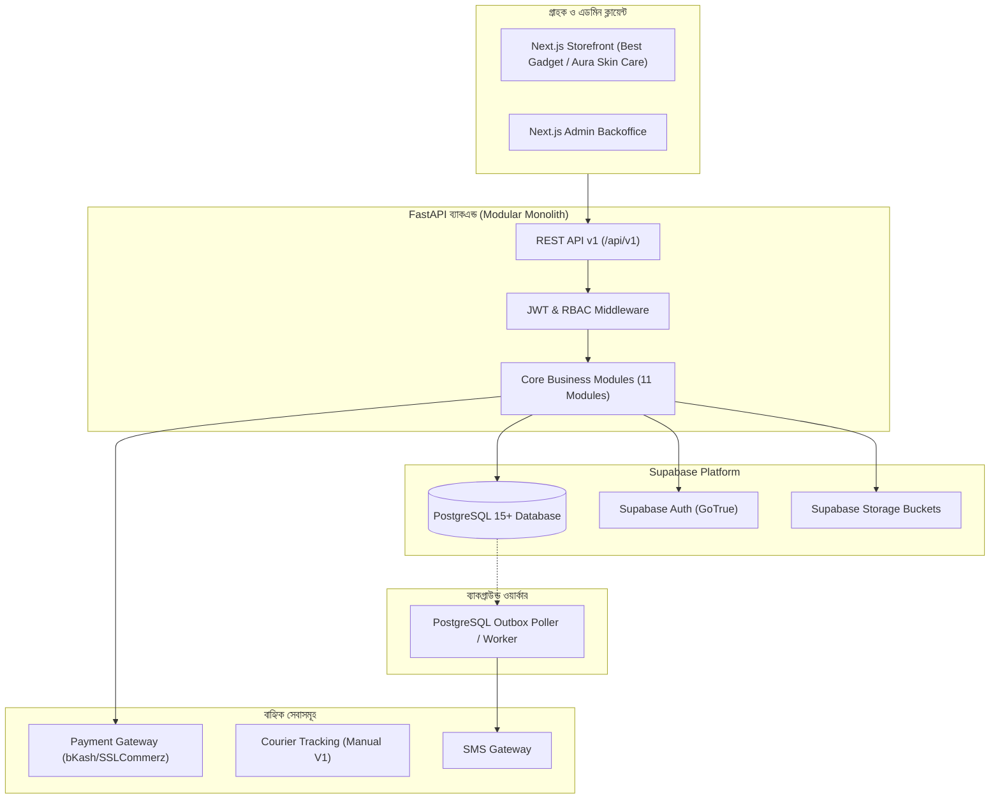

# Aura Bell — High-Level System Architecture (সিস্টেম আর্কিটেকচার)

## ১. আর্কিটেকচারাল সারসংক্ষেপ (Executive Summary)
Aura Bell প্ল্যাটফর্মের প্রাথমিক আর্কিটেকচার হবে একটি **Modular Monolith**। 
অপ্রয়োজনীয় জটিলতা, ডিস্ট্রিবিউটেড নেটওয়ার্ক লেটেন্সি এবং অতিরিক্ত সার্ভার খরচ পরিহার করে একক কোডবেসে সুস্পষ্ট মডিউল বাউন্ডারি দিয়ে প্ল্যাটফর্মটি তৈরি করা হয়েছে।

---

## ২. প্রযুক্তিগত ভিত্তি ও দায়িত্ব বণ্টন (Approved Technology Stack)

| স্তর (Layer) | প্রযুক্তি | দায়িত্ব ও ব্যবহারের কারণ |
|---|---|---|
| **Frontend** | **Next.js (React + TypeScript)** | সার্ভার-সাইড রেন্ডারিং (SSR), এসইও ফ্রেন্ডলি স্টোরফ্রন্ট এবং দ্রুত ইন্টারফেস। |
| **Styling** | **Tailwind CSS** | মোবাইল-ফার্স্ট রেসপন্সিভ ডিজাইন ও কনসিস্টেন্ট ডিজাইন সিস্টেম। |
| **Backend** | **FastAPI (Python 3.11+)** | হাই-পারফরম্যান্স অ্যাসিঙ্ক হ্যান্ডলিং, Pydantic v2 ভ্যালিডেশন এবং অটো OpenAPI ডক। |
| **Database** | **Supabase PostgreSQL 15+** | শক্তিশালী রিলেশনাল কনস্ট্রেইন্ট, ACID ট্রানজ্যাকশন এবং Row Level Security। |
| **Auth** | **Supabase Auth** | নিরাপদ গো-ট্রু অথেনটিকেশন, পাসওয়ার্ড হ্যাশিং ও JWT ভ্যালিডেশন। |
| **Storage** | **Supabase Storage** | পণ্য ও ডকুমেন্টের ছবি নিরাপদ ক্লাউড বাকেটে সংরক্ষণ। |
| **Async Jobs** | **PostgreSQL Outbox Pattern** | কোনো কাফকা বা খরুচে মেসেজ ব্রোকার ছাড়াই ট্রানজ্যাকশনাল ইভেন্ট প্রসেসিং। |
