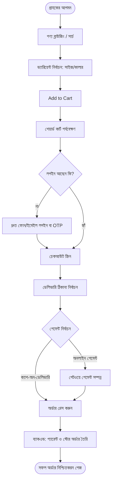

# Aura Bell — End-to-End User Flows (ব্যবহারকারী প্রবাহ)

## 6. 3D মল এক্সপিরিয়েন্সের হ্যান্ডলিং
* **3D মল থেকে এন্ট্রি:** `Start` নোড থেকে নতুন ব্রাঞ্চ যোগ করা:
    `Start --> 3D_Mall_Entry[3D মল এন্ট্রি করুন (স্বেচ্ছাসেবিক)]`
* **3D মল নেভিগেশন:** 3D মল এন্ট্রিতে প্রবেশ করলে:
    `3D_Mall_Entry --> 3D_Environment[3D ভার্চুয়াল মল পরিবেশ]
    3D_Environment --> Enter_Store[যে কোনো স্টোর এন্ট্রি এপ্রোচ করুন]
    Enter_Store --> 3D_To_2D_Transition[3D থেকে 2D স্টোরফ্রন্টে ট্রানজিশন]
    3D_To_2D_Transition --> Success([2D স্টোরফ্রন্টে অবতরণ])`
* **3D বিকল্প:** 2D স্টোরিং বিকল্পটি বেছে নিলে:
    `Start --> 2D_Shopping[2D শপিং পছন্দ করুন]
    2D_Shopping --> Browse[পণ্য ব্রাউজিং / সার্চ]
    Browse --> Select[ভ্যারিয়েন্ট নির্বাচন: সাইজ/কালার]
    Select --> AddCart[Add to Cart]
    AddCart --> ViewCart[শেয়ার্ড কার্ট পর্যবেক্ষণ]`
* **মোবাইল সেটিংস:** মোবাইল ডিভাইসে 3D মল এক্সপেরিয়েন্স:
    `3D_Environment --> Mobile_3D_Controls[মোবাইল জয়স্টিক + টাচ কন্ট্রোল]
    Mobile_3D_Controls --> Enter_Store[এপ্রোচ করা যায়]`
