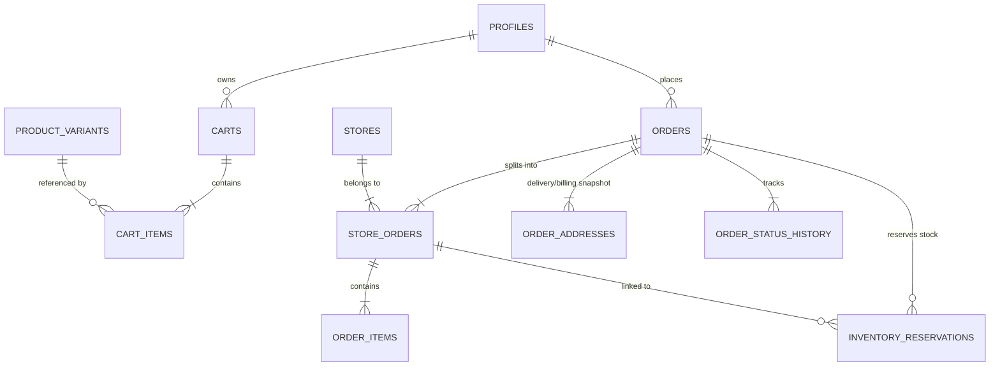

# AURA BELL — মাইলস্টোন ৪ (M4) মাস্টার এক্সিকিউশন ও ইমপ্লিমেন্টেশন প্ল্যান
**Document ID**: `DOC-AUR-174`  
**শিরোনাম**: Shared Cart, Server-Side Checkout Calculation, Split-Order Engine & COD Verification  
**তারিখ**: ১৭ নভেম্বর ২০২৬  
**সংস্করণ**: 1.0.0  
**স্ট্যাটাস**: অনুমোদিত ও বাস্তবায়ন-প্রস্তুত (Approved & Ready for Execution)  
**বিভাগ**: `10_DEVELOPMENT_WORKFLOW`  
**SSOT রেফারেন্স**: `DOC-AUR-031` (Business Rules), `DOC-AUR-046` (Cart PRD), `DOC-AUR-047` (Order PRD), `DEC-OWN-002`, `DEC-OWN-003`

---

## ১. নির্বাহী ওভারভিউ ও উদ্দেশ্য (Executive Overview)

মাইলস্টোন ৪ (M4) হলো Aura Bell প্ল্যাটফর্মের কোর কমার্স পাইপলাইনের প্রাণকেন্দ্র। এই মাইলস্টোনের উদ্দেশ্য হলো:
1. একাধিক স্বতন্ত্র স্টোরের (যেমন: Best Gadget এবং Aura Skin Care) পণ্যকে একটি একক **শেয়ার্ড কার্টে (Shared Cart)** রাখা।
2. ফ্রন্টএন্ডের কোনো প্রাইস বা ক্যালকুলেশনকে বিশ্বাস না করে শতভাগ **সার্ভার-সাইড ডাটাবেজ প্রাইস অথোরিটি** নিশ্চিত করা।
3. চেকআউটের মুহূর্তে একটিমাত্র **অ্যাটমিক ডাটাবেজ ট্রানজ্যাকশনে (Atomic DB Transaction)** সেন্ট্রাল **Parent Order** এবং স্টোরভিত্তিক **Split Store Orders** তৈরি করা।
4. কনকারেন্সি-সেফ ১৫ মিনিটের **স্টক রিজার্ভেশন (Stock Reservation)** যুক্ত করা।
5. বাংলাদেশে ক্যাশ-অন-ডেলিভারি (COD) অর্ডারের ক্ষেত্রে রিটার্ন/ফ্রড (RTO) প্রতিরোধের জন্য **৪-ডিজিটের SMS OTP ভেরিফিকেশন** সম্পন্ন করে অর্ডার কনফার্ম করা।

---

## ২. অলঙ্ঘনীয় নীতিমালা ও কনস্ট্রেইন্টস (Inviolable Architectural Constraints)

বাস্তবায়নের সময় নিচের ১২টি বিজনেস রুলস ও ওনার সিদ্ধান্ত অক্ষরে অক্ষরে পালন করতে হবে:

| নীতি / আইডি | নিয়ম | প্রযুক্তিগত প্রয়োগ |
|---|---|---|
| `RULE-AUR-001` | **DB-Driven Stock Truth** | কোনো ইন-মেমোরি বা ক্লায়েন্ট স্টেট গ্রাহ্য হবে না; PostgreSQL ব্যালেন্সই চূড়ান্ত। |
| `RULE-AUR-002` | **Server-Side Price Authority** | ক্লায়েন্ট থেকে পাঠানো কোনো পণ্যের দাম বা ডিসকাউন্ট গ্রাহ্য হবে না; ডাটাবেজ থেকে অ্যাক্টিভ প্রাইস নিয়ে হিসাব হবে। |
| `RULE-AUR-003` | **Mandatory Stock Reservation** | অর্ডার তৈরি ও কনফার্মেশনের পূর্বে `SELECT FOR UPDATE` দিয়ে ১৫ মিনিটের রিজার্ভেশন সম্পন্ন হতে হবে। |
| `RULE-AUR-004` | **Independent State Engines** | `orders.order_status` ('pending' -> 'confirmed' -> 'processing' -> 'completed'/'cancelled') স্বাধীন এনামে চলবে। |
| `RULE-AUR-006` | **Immutable Order Snapshots** | অর্ডারের সময় পণ্যের নাম, এসকেইউ ও মূল্য `order_items` টেবিলে হুবহু স্ন্যাপশট হিসেবে কপি হবে; ভবিষ্যতে ক্যাটালগ বদলালেও অতীত অর্ডার অক্ষুণ্ণ থাকবে। |
| `RULE-AUR-008` | **Pre-Checkout Shipping Transparency** | চেকআউটের পূর্বেই ডেলিভারি ফি স্বচ্ছভাবে হিসাব করে দেখাতে হবে। |
| `DEC-OWN-002` | **15-Minute Reservation TTL** | রিজার্ভেশন টাইমআউট ১৫ মিনিট (`NOW() + INTERVAL '15 minutes'`)। |
| `DEC-OWN-003` | **Flat Delivery Fee Policy** | ঢাকা মেট্রো ৭০ টাকা, ঢাকার বাইরে ১২০ টাকা। স্টোর বা শিপমেন্টের সংখ্যা যাই হোক না কেন, প্যারেন্ট অর্ডারে একক ফ্ল্যাট ফি প্রযোজ্য হবে। |

---

## ৩. আর্কিটেকচার ও ডেটা মডেল রিলেশনশিপ (Data Architecture)

### ডাটাবেজ টেবিল স্কিমা ম্যাপিং (`Migration 004` অনুযায়ী)
1. **`carts`**: `id`, `user_id` (ঐচ্ছিক), `session_id` (গেস্টের জন্য), `status` ('active', 'converted', 'abandoned')
2. **`cart_items`**: `id`, `cart_id`, `variant_id`, `quantity`, `UNIQUE(cart_id, variant_id)`
3. **`orders`**: `id`, `order_number`, `user_id`, `subtotal`, `discount_total`, `delivery_total`, `grand_total`, `currency_code` ('BDT'), `order_status` ('pending', 'confirmed', 'processing', 'completed', 'cancelled')
4. **`store_orders`**: `id`, `order_id`, `store_id`, `store_order_number`, `subtotal`, `delivery_fee`, `status`, `UNIQUE(order_id, store_id)`
5. **`order_items`**: `id`, `store_order_id`, `variant_id`, `product_name_snapshot`, `sku_snapshot`, `variant_snapshot` (JSONB), `unit_price`, `quantity`, `discount_amount`, `line_total`
6. **`order_addresses`**: `id`, `order_id`, `recipient_name`, `phone`, `division`, `district`, `upazila`, `area`, `address_line`, `postal_code`, `address_type` ('delivery', 'billing', 'both')
7. **`order_status_history`**: `id`, `order_id`, `old_status`, `new_status`, `changed_by`, `note`

---

## ৪. ধাপে ধাপে এক্সিকিউশন রোডম্যাপ (Phase-by-Phase Roadmap)

### ধাপ ০: প্রি-রিকুইজিট ও প্রিপারেশন (Prerequisites & Scaffolding)
- [ ] `backend/app/modules/cart/` এর বিদ্যমান অসম্পূর্ণ ড্রাফট কোড ক্লিন করে স্ট্যান্ডার্ড SQLAlchemy `text()` এবং Pydantic v2 স্কিমায় রূপান্তর করা।
- [ ] নতুন মডিউল `backend/app/modules/orders/` তৈরি করা (`__init__.py`, `schema.py`, `service.py`, `router.py`)।
- [ ] `backend/app/main.py`-তে কার্ট ও অর্ডার রাউটারগুলো `/api/v1` প্রিফিক্সে রেজিস্টার করা।

---

### ধাপ ১: M4.1 — মাল্টি-স্টোর শেয়ার্ড কার্ট ইঞ্জিন (`app.modules.cart`)
*একাধিক স্টোরের আইটেম এক কার্টে রাখা, গেস্ট টু ইউজার কার্ট মার্জ, এবং রিয়েল-টাইম ভ্যালিডেশন।*

- **১.১ কার্ট সেশন ও ইনিশিয়ালাইজেশন**:
  - রেজিস্টার্ড ইউজারের জন্য `user_id` দ্বারা কার্ট চিহ্নিত করা।
  - নন-লগইন কাস্টমারের জন্য `session_id` (UUID বা সুরক্ষিত কুকি/হেডার) দ্বারা সক্রিয় কার্ট বের করা বা তৈরি করা।
  - ইউজার লগইন করলে গেস্ট কার্টের আইটেমগুলো ইউজারের সক্রিয় কার্টের সাথে স্বয়ংক্রিয়ভাবে মার্জ (Merge) করা।
- **১.২ আইটেম যুক্তকরণ ও আপডেট (`add_item`, `update_quantity`, `remove_item`)**:
  - একই ভ্যারিয়েন্ট পুনরায় যোগ করলে কোয়ান্টিটি বৃদ্ধি করা।
  - কোয়ান্টিটি ০ বা নেগেটিভ হলে আইটেমটি কার্ট থেকে স্বয়ংক্রিয়ভাবে মুছে ফেলা।
  - আইটেম যুক্ত করার সময় `product_variants.is_active` এবং প্যারেন্ট `products.status = 'active'` সত্য কি না যাচাই করা।
- **১.৩ কার্ট ডিটেইলস ও লাইভ ভ্যালিডেশন (`get_cart`)**:
  - কার্টের আইটেমগুলো লোড করার সময় প্রতিটি আইটেমের বর্তমান স্টোর ইনফো (`store_id`, `store_name`), বর্তমান বিডিটি প্রাইস এবং ইনভেন্টরি স্টক স্ট্যাটাস (`in_stock: true/false`, `available_qty`) যুক্ত করে রেসপন্স দেওয়া।

---

### ধাপ ২: M4.2 — সার্ভার-সাইড চেকআউট ও প্রাইসিং ক্যালকুলেশন ইঞ্জিন
*চেকআউট প্রিভিউ, স্টোর-ব্রেকডাউন এবং ফ্ল্যাট ডেলিভারি চার্জ নির্ধারণ।*

- **২.১ ডায়নামিক সার্ভার-সাইড প্রাক-গণনা (`checkout_preview`)**:
  - কার্ট আইটেমগুলোর জন্য `PricingService.calculate_price()` কল করে বর্তমান কার্যকর মূল্য ও কুপন ডিসকাউন্ট হিসাব করা।
  - স্টোরভিত্তিক সাবটোটাল ও আইটেম গ্রুপিং তৈরি করা (যেমন: Best Gadget Subtotal + Aura Skin Care Subtotal)।
- **২.২ ওনার অনুমোদিত ডেলিভারি ফি পলিসি (`DEC-OWN-003`) প্রয়োগ**:
  - ডেলিভারি ঠিকানার জেলা (`district`) যাচাই:
    - `district.lower() in ['dhaka', 'ঢাকা']` ➡️ **৭০.০০ BDT** (ঢাকা মেট্রো)।
    - অন্যান্য সকল জেলা ➡️ **১২০.০০ BDT** (ঢাকার বাইরে)।
  - কার্টে যতগুলো স্টোরের পণ্যই থাকুক না কেন, গ্রাহকের জন্য অর্ডারে একক ফ্ল্যাট ফি ধার্য করা হবে।
  - স্টোর অর্ডারের ক্ষেত্রে ডেলিভারি ফি প্রথম স্টোর অর্ডারে যুক্ত হবে অথবা আনুপাতিকভাবে স্প্লিট হবে (প্যারেন্ট অর্ডারের টোটাল অপরিবর্তিত থাকবে)।
- **২.৩ গ্র্যান্ড টোটাল নির্ধারণ**:
  $$\text{Grand Total} = (\text{Subtotal} - \text{Discount Total}) + \text{Delivery Total}$$

---

### ধাপ ৩: M4.3 — অ্যাটমিক স্প্লিট-অর্ডার ট্রানজ্যাকশন ইঞ্জিন (`app.modules.orders`)
*একটিমাত্র ডাটাবেজ ট্রানজ্যাকশনে প্যারেন্ট অর্ডার, স্টোর অর্ডার, আইটেম স্ন্যাপশট ও স্টক রিজার্ভেশন সম্পন্ন করা।*

- **৩.১ অর্ডার প্লেসমেন্ট রিকোয়েস্ট ভ্যালিডেশন**:
  - ইনপুট: `cart_id`, `delivery_address` (নাম, ফোন, জেলা, ঠিকানা), `payment_method` ('cod', 'bkash', 'sslcommerz'), `coupon_code` (ঐচ্ছিক)।
  - কার্ট খালি কি না এবং ডেলিভারি ফোন নম্বর সঠিক বাংলাদেশি ফরম্যাটে (+8801... / 01...) আছে কি না ভ্যালিডেট করা।
- **৩.২ অ্যাটমিক ট্রানজ্যাকশন ব্লকে এক্সিকিউশন (`async with db.begin():`)**:
  1. **ইউনিক অর্ডার নম্বর তৈরি**: `AB-YYYYMMDD-XXXX` ফরম্যাটে হিউম্যান-রিডেবল ইউনিক `order_number` জেনারেট করা।
  2. **প্যারেন্ট অর্ডার (`orders`) ইনসার্ট**: `order_status = 'pending'`, সাবটোটাল, ডিসকাউন্ট, ডেলিভারি ফি এবং গ্র্যান্ড টোটালসহ রেকর্ড তৈরি।
  3. **ডেলিভারি অ্যাড্রেস স্ন্যাপশট (`order_addresses`) ইনসার্ট**: অর্ডারের মুহূর্তের ডেলিভারি ঠিকানা স্থায়ী স্ন্যাপশট হিসেবে সংরক্ষণ।
  4. **স্টোরভিত্তিক গ্রুপিং ও স্প্লিটিং (`store_orders`)**:
     - কার্টের আইটেমগুলোকে `store_id` অনুসারে গ্রুপ করা।
     - প্রতিটি স্টোরের জন্য একটি করে `store_orders` রো তৈরি করা (`store_order_number: AB-SO-{STORE_CODE}-XXXX`)।
  5. **অপরিবর্তনীয় আইটেম স্ন্যাপশট (`order_items`) ইনসার্ট**:
     - প্রতিটি আইটেমের নাম (`product_name_snapshot`), এসকেইউ (`sku_snapshot`), ভ্যারিয়েন্ট অ্যাট্রিবিউটস (`variant_snapshot` JSONB), এবং কার্যকর ইউনিট প্রাইস হুবহু কপি করা।
  6. **স্টক রিজার্ভেশন সম্পন্নকরণ (`inventory_reservations`)**:
     - প্রতিটি ভ্যারিয়েন্টের জন্য `InventoryService.create_reservation()` কল করে সেন্ট্রাল ওয়্যারহাউসে ১৫ মিনিটের TTL সহ স্টক রিজার্ভ করা।
     - রিজার্ভেশন রো-তে `order_id` এবং সংশ্লিষ্ট `store_order_id` লিঙ্ক করা।
  7. **কুপন রিডেম্পশন রেকর্ড (`promotion_redemptions`)**:
     - কুপন ব্যবহার হয়ে থাকলে রিডেম্পশন টেবিলে এন্ট্রি দেওয়া।
  8. **স্ট্যাটাস হিস্ট্রি (`order_status_history`)**:
     - `new_status = 'pending'`, `note = 'Order placed via checkout'` রেকর্ড সংরক্ষণ।
  9. **কার্ট কনভার্ট করা (`carts.status = 'converted'`)**:
     - কার্টটি সফলভাবে অর্ডারে রূপান্তরিত হিসেবে মার্ক করা।

---

### ধাপ ৪: M4.4 — COD ফ্রড প্রতিরোধ ও ৪-ডিজিটের SMS OTP ভেরিফিকেশন
*ক্যাশ-অন-ডেলিভারি অর্ডারে ফেক কাস্টমার ও RTO কমানোর জন্য ওটিপি ভেরিফিকেশন।*

- **৪.১ ওটিপি জেনারেশন ও ডেলিভারি (`generate_cod_otp`)**:
  - পেমেন্ট মেথড `COD` হলে সিস্টেম ৪-ডিজিটের ক্রিপ্টোগ্রাফিক র‍্যান্ডম ওটিপি জেনারেট করবে।
  - ওটিপি হ্যাশ এবং এক্সপায়ারি টাইম (৫ মিনিট) অর্ডারের সাথে বা ভেরিফিকেশন স্টেট টেবিলে সংরক্ষিত থাকবে।
  - ডেভেলপার/টেস্টিং মোডে কনসোলে লগ হবে এবং এসএমএস গেটওয়ে রেডি ইন্টারফেসে পাঠানো হবে।
- **৪.২ ওটিপি ভেরিফিকেশন এপিআই (`POST /api/v1/orders/{order_id}/verify-cod`)**:
  - ইনপুট: `otp_code` (৪ ডিজিট)।
  - ৩ বার ভুল কোড দিলে ওটিপি বাতিল হয়ে যাবে।
  - ওটিপি সঠিক হলে:
    1. `orders.order_status` 'pending' থেকে **'confirmed'**-এ আপডেট হবে।
    2. প্রতিটি `store_orders.status` **'confirmed'** হবে।
    3. `order_status_history`-তে `note: 'COD verified via SMS OTP'` লিপিবদ্ধ হবে।
    4. রেসপন্সে কনফার্মড অর্ডার ডিটেইলস রিটার্ন করবে।

---

### ধাপ ৫: স্বয়ংক্রিয় টেস্ট স্যুট ও এজ-কেস ভেরিফিকেশন (Pytest Suite)
*সকল লজিকের জন্য ১০০% রিগ্রেশন-প্রুফ টেস্ট ফাইল তৈরি করা।*

- **৫.১ `test_cart.py` (কার্ট টেস্ট)**:
  - গেস্ট কার্ট তৈরি ও আইটেম যোগ/বিয়োগ।
  - একই আইটেম পুনরায় যোগে কোয়ান্টিটি ইনক্রিমেন্ট।
  - নিষ্ক্রিয় বা অস্তিত্বহীন প্রোডাক্ট যোগ করার চেষ্টা করলে ৪২২/৪০৪ এরর।
  - গেস্ট কার্ট থেকে ইউজার কার্ট মার্জ টেস্ট।
- **৫.২ `test_checkout_calculation.py` (প্রাইসিং ও ডেলিভারি ফি টেস্ট)**:
  - ঢাকা মেট্রোর ঠিকানায় ৭০ টাকা ফি যাচাই।
  - ঢাকার বাইরের ঠিকানায় ১২০ টাকা ফি যাচাই।
  - মাল্টি-স্টোর প্রোডাক্টের কম্বাইন্ড কার্টেও একক ফ্ল্যাট ফি নিশ্চিতকরণ।
  - কুপন কোড প্রয়োগে সঠিক সাবটোটাল ও ডিসকাউন্ট ভ্যালিডেশন।
- **৫.৩ `test_orders.py` (স্প্লিট-অর্ডার ট্রানজ্যাকশন টেস্ট)**:
  - ২ স্টোরের পণ্য নিয়ে অর্ডার করলে ১টি প্যারেন্ট অর্ডার ও ২টি স্টোর অর্ডার তৈরি হওয়া।
  - `order_items`-এ সঠিক স্ন্যাপশট ও লাইন টোটাল সংরক্ষণ যাচাই।
  - অর্ডার তৈরির সাথে সাথে ওয়্যারহাউসে ১৫ মিনিটের স্টক রিজার্ভেশন নিশ্চিতকরণ।
  - স্টকে অপর্যাপ্ত পণ্য থাকলে ট্রানজ্যাকশন রোলব্যাক ও অর্ডার ফেইল হওয়া।
- **৫.৪ `test_cod_verification.py` (ওটিপি ও ফ্রড টেস্ট)**:
  - সিওডি অর্ডারে ওটিপি ছাড়া স্ট্যাটাস 'pending' থাকা।
  - সঠিক ওটিপি প্রদানে অর্ডার 'confirmed' হওয়া।
  - ভুল ওটিপিতে এরর এবং ৩ বারের বেশি চেষ্টায় লকআউট।

---

### ধাপ ৬: কোয়ালিটি গেট ও গিট ফাইনাল ওয়ার্কফ্লো
- [ ] সম্পূর্ণ টেস্ট স্যুট রান করা (`pytest backend/tests/` -> পূর্বের ১১৪টি টেস্টের সাথে সকল নতুন টেস্ট পাস হতে হবে)।
- [ ] কোড কমপ্লায়েন্স ও টাইপ-চেক (`python -m compileall backend/app`).
- [ ] রুট ফোল্ডারের [MILESTONES.md](file:///d:/navil/TCH/Aura%20bell/MILESTONES.md) ফাইলের TODO লিস্টে M4.1 থেকে M4.4 টিকমার্ক দিয়ে আপডেট করা।
- [ ] গিট কমিট ও পুশ: বর্ণনামূলক মেসেজসহ `feat(M4): complete shared cart, split orders & COD engine`.

---

## ৫. এপিআই এন্ডপয়েন্ট স্পেসিফিকেশন চার্ট (API Endpoints Specification)

| মেথড | এন্ডপয়েন্ট ইউআরএল | অথরাইজেশন | বিবরণ |
|---|---|---|---|
| `GET` | `/api/v1/cart` | Optional (User/Guest) | বর্তমান সক্রিয় কার্ট ও আইটেম লোড |
| `POST` | `/api/v1/cart/items` | Optional (User/Guest) | কার্টে ভ্যারিয়েন্ট যোগ করা |
| `PATCH` | `/api/v1/cart/items/{variant_id}` | Optional (User/Guest) | কার্ট আইটেমের কোয়ান্টিটি পরিবর্তন |
| `DELETE` | `/api/v1/cart/items/{variant_id}` | Optional (User/Guest) | কার্ট থেকে আইটেম মুছে ফেলা |
| `GET` | `/api/v1/cart/preview` | Authenticated | চেকআউট প্রাইস, ডিসকাউন্ট ও ডেলিভারি ফি প্রিভিউ |
| `POST` | `/api/v1/orders/checkout` | Authenticated | অ্যাটমিক অর্ডার প্লেসমেন্ট ও স্প্লিট অর্ডার তৈরি |
| `POST` | `/api/v1/orders/{order_id}/verify-cod` | Authenticated / Phone | সিওডি অর্ডারের জন্য ৪-ডিজিট ওটিপি ভেরিফিকেশন |
| `GET` | `/api/v1/orders/{order_id}` | Authenticated (Owner/Admin) | অর্ডারের বিস্তারিত প্যারেন্ট ও চাইল্ড তথ্য প্রদর্শন |
| `GET` | `/api/v1/orders` | Authenticated (Customer) | কাস্টমারের নিজস্ব অতীত অর্ডার তালিকা |

---

## ৬. সারসংক্ষেপ ও প্রস্তুতি (Readiness Confirmation)

এই এক্সিকিউশন প্ল্যানটি অরা বেলের মূল স্থাপত্য (Blueprint), বিজনেস রুলস (`RULE-AUR-001` থেকে `RULE-AUR-012`), ডাটাবেজ স্কিমা মাইগ্রেশন ৪, এবং ওনার ডিসিশনগুলোর সাথে ১০০% সামঞ্জস্যপূর্ণ। 

আপনি সম্মতি দিলেই আমরা অবিলম্বে **ধাপ ০ ও ধাপ ১ (কার্ট ইঞ্জিন)** থেকে কোডিং বাস্তবায়ন শুরু করতে প্রস্তুত।
