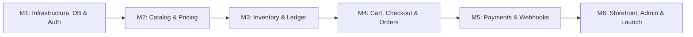

# AURA BELL — MASTER IMPLEMENTATION MILESTONES (মাস্টার মাইলস্টোন প্ল্যান)

**প্রকল্প:** Aura Bell (Multi-Store E-commerce: Best Gadget & Aura Skin Care)  
**আর্কিটেকচার:** Modular Monolith (FastAPI + Supabase PostgreSQL + Next.js)  
**ভার্সন:** 1.1  
**সর্বশেষ আপডেট:** 2026-11-08  
**অনুমোদন স্থিতি:** APPROVED & READY FOR EXECUTION  

---

## 🎯 এক্সিকিউশন দর্শন (Execution Philosophy)

ডকুমেন্টেশন ও আর্কিটেকচার ব্লুপ্রিন্ট পর্ব সফলভাবে সম্পন্ন হয়েছে। এখন প্রকল্পটিকে বাস্তব রূপ দিতে সমগ্র সফটওয়্যার উন্নয়নকে **৬টি প্রধান মাইলস্টোন (6 Main Milestones)** এবং তাদের অধীনস্থ সুনির্দিষ্ট **সাব-মাইলস্টোনে (Sub-Milestones)** বিভক্ত করা হয়েছে।

প্রতিটি মাইলস্টোনের লক্ষ্য হলো:

1. **ভিত্তি শক্ত করা**: অবকাঠামো ও ডাটাবেজ দিয়ে শুরু করে ধাপে ধাপে কমার্স লজিক এবং ইউজার ইন্টারফেসে যাওয়া।
2. **জিরো কনফ্লিক্ট**: ব্লুপ্রিন্টের অনুমোদিত সিদ্ধান্ত (FastAPI, Supabase, ৪৩টি টেবিল, ১৫ মিনিট TTL, ফ্ল্যাট শিপিং, bKash+SSLCommerz) হুবহু বাস্তবায়ন করা।
3. **পরিমাপযোগ্য ডেলিভারি**: প্রতিটি সাব-মাইলস্টোনের সুনির্দিষ্ট কোডিং ডেলিভারেবল এবং টেস্টেবল একসেপ্টেন্স ক্রাইটেরিয়া নিশ্চিত করা।

---

## MILESTONE 1 (M1): Infrastructure, Database & Foundation Scaffolding
>
> **লক্ষ্য:** ব্যাকএন্ড মনোলিথ রিপোজিটরি সেটআপ, সুপাবেজ ডাটাবেজের ৪৩টি টেবিলের ডিডিএল মাইগ্রেশন এবং নিরাপদ গো-ট্রু অথেনটিকেশন লেয়ার প্রতিষ্ঠা।

### সাব-মাইলস্টোনসমূহ

* **M1.1: Backend Repository & Config Scaffolding**
  * পাইথন ৩.১১+ সহ FastAPI প্রজেক্ট স্ট্রাকচার তৈরি (`app/core/`, `app/modules/`, `app/workers/`)।
  * Pydantic v2 `BaseSettings` ভিত্তিক এনভায়রনমেন্ট কনফিগারেশন লোডার (`.env` সাপোর্ট)।
  * SQLAlchemy 2.0 AsyncEngine ও ডাটাবেজ সেশন ম্যানেজার সেটআপ।
  * ডকার কনটেইনারাইজেশন (`Dockerfile`, `docker-compose.yml`) ও হেলথচেক এন্ডপয়েন্ট (`/api/v1/health`)।

* **M1.2: Supabase PostgreSQL DDL Migration Execution**
  * পোস্টগ্রেস এক্সটেনশন এনেবল (`uuid-ossp`, `pgcrypto`)।
  * গ্লোবাল টাইমস্ট্যাম্প ট্রিগার ফাংশন (`set_updated_at()`) প্রয়োগ।
  * ৪৩টি রিলেশনাল টেবিল, পোস্টগ্রেস এনামস, চেক কনস্ট্রেইন্টস এবং ফরেন কি ক্যাস্কেড স্ক্রিপ্ট এক্সিকিউট করা।
  * Row Level Security (RLS) পলিসি ইনিশিয়ালাইজেশন।

* **M1.3: Core Identity & Auth Integration**
  * Supabase Auth (GoTrue) পিকেসিই ফ্লো ও ওটিপি/ইমেইল লগইন মিডলওয়্যার তৈরি।
  * বিয়ারার JWT টোকেন সিগনেচার, এক্সপায়ারি ও অডিয়েন্স ভ্যালিডেশন।
  * রোল-বেসড এক্সেস কন্ট্রোল (RBAC) ডিপেন্ডেন্সি ইনজেকশন (`require_role()`)।
  * ইউজার প্রোফাইল (`profiles`) ও অ্যাড্রেস বুক (`addresses`) CRUD এপিআই।

* **M1.4: Base Seed Data Initialization**
  * সিস্টেম রোলস (`Super Admin`, `Store Manager`, `Inventory Manager`, `Customer`) সিডিং।
  * ডিফল্ট সেন্ট্রাল ওয়্যারহাউস (`Main Central Warehouse`) সিডিং।
  * প্রাথমিক দুটি ফ্ল্যাগশিপ স্টোর সিডিং: **Best Gadget** (`best-gadget`) ও **Aura Skin Care** (`aura-skin-care`)।

---

## MILESTONE 2 (M2): Multi-Store Catalog & Pricing Engine
>
> **লক্ষ্য:** স্বাধীন স্টোর ব্র্যান্ডিং, ক্যাটাগরি হায়ারার্কি, প্রোডাক্ট ভ্যারিয়েন্ট ও সার্ভার-সাইড প্রাইসিং ইঞ্জিন নির্মাণ।

### সাব-মাইলস্টোনসমূহ

* **M2.1: Store Management & Policy Engine**
  * স্টোর তথ্য, স্লাগ, লোগো, ব্যানার ও স্ট্যাটাস ম্যানেজমেন্ট এপিআই (`stores`)।
  * স্টোরভিত্তিক পৃথক রিটার্ন, ওয়ারেন্টি ও টার্মস পলিসি হ্যান্ডলিং (`store_policies`)।

* **M2.2: Category Hierarchy & Attributes Engine**
  * প্যারেন্ট-চাইল্ড ক্যাটাগরি ট্রি ম্যানেজমেন্ট (`categories`)।
  * Skincare এর জন্য উপাদান (Ingredients), স্কিন টাইপ ও ব্যবহারবিধি অ্যাট্রিবিউটস কনফিগারেশন।
  * Gadget এর জন্য মডেল, স্পেসিফিকেশন ও ওয়ারেন্টি মেটাডাটা কনফিগারেশন (`product_attributes`)।

* **M2.3: Product Catalog & Variant Generator**
  * মূল প্রোডাক্ট ক্রিয়েশন ও স্লাগ জেনারেটর (`products`)।
  * সাইজ, কালার, ভলিউম ভিত্তিক স্বতন্ত্র SKU জেনারেশন (`product_variants`)।
  * Supabase Storage বাকেটে ইমেজ আপলোড ও প্রাইমারি থাম্বনেইল নির্বাচন (`product_images`)।

* **M2.4: Server-Side Pricing Engine**
  * ভ্যারিয়েন্টের রেগুলার প্রাইস ও সেল প্রাইস ম্যানেজমেন্ট (`product_prices`)।
  * BDT কারেন্সি ক্যালকুলেশন ও কুপন কোড প্রমোশন ভ্যালিডেশন (`promotions`)।
  * ফ্রন্টএন্ড প্রাইস টেম্পারিং প্রতিরোধে সার্ভার-সাইড প্রাইস ভ্যালিডেশন লজিক।

---

## MILESTONE 3 (M3): Concurrency-Safe Inventory & Warehouse Ledger
>
> **লক্ষ্য:** জিরো ওভারসেলিং, অ্যাটমিক স্টক রিজার্ভেশন (১৫ মিনিট TTL) এবং অপরিবর্তনীয় ডিজিটাল স্টক লেজার নিশ্চিত করা।

### সাব-মাইলস্টোনসমূহ

* **M3.1: Warehouse Stock Balances**
  * ওয়্যারহাউস ও ভ্যারিয়েন্ট ভিত্তিতে `quantity_on_hand` এবং `quantity_reserved` ট্র্যাকিং।
  * ডাটাবেজ স্তরে নন-নেগেটিভ চেক কনস্ট্রেইন্ট বজায় রাখা (Zero Negative Stock Invariant)।

* **M3.2: Atomic Stock Reservation Engine**
  * চেকআউটের মুহূর্তে কনকারেন্সি-সেফ `SELECT ... FOR UPDATE` রো-লকিং দিয়ে স্টক হোল্ড করা।
  * ১৫ মিনিটের টাইম-টু-লিভ (TTL) সহ `inventory_reservations` রেকর্ড তৈরি।

* **M3.3: Automatic Reservation Cleanup Worker**
  * ব্যাকগ্রাউন্ড ওয়ার্কার বা ক্রন জব যা প্রতি ১ মিনিটে রান হয়ে মেয়াদোত্তীর্ণ রিজার্ভেশন চিহ্নিত করবে।
  * মেয়াদোত্তীর্ণ রিজার্ভেশন বাতিল করে স্টক স্বয়ংক্রিয়ভাবে মূল ইনভেন্টরিতে ফেরত দেওয়া।

* **M3.4: Immutable Stock Movement Ledger**
  * প্রতিটি স্টকের আগমণ, রিজার্ভেশন, বিক্রয়, রিটার্ন ও ফিজিক্যাল অ্যাডজাস্টমেন্টের জন্য `stock_movements` টেবিলে অপরিবর্তনীয় অডিট এন্ট্রি সংরক্ষণ।

* **M3.5: Specialized Tracking (Batch & Serial)**
  * স্কিনকেয়ার পণ্যের জন্য ম্যানুফ্যাকচারিং, ব্যাচ নম্বর ও এক্সপায়ারি ডেট ট্র্যাকিং (`product_batches`)।
  * গ্যাজেট পণ্যের জন্য ইউনিক সিরিয়াল বা IMEI নম্বর ট্র্যাকিং (`product_serials`)।

---

## MILESTONE 4 (M4): Shared Cart & Unified Split-Order Checkout Engine
>
> **লক্ষ্য:** মাল্টি-স্টোর শেয়ার্ড কার্ট, সার্ভার-সাইড টোটাল রিক্যালকুলেশন, প্যারেন্ট-চাইল্ড স্প্লিট অর্ডার জেনারেশন এবং সিওডি অর্ডার ফ্রড প্রতিরোধ।

### সাব-মাইলস্টোনসমূহ

* **M4.1: Multi-Store Shared Shopping Cart**
  * একই কার্টে Best Gadget এবং Aura Skin Care উভয়ের পণ্য যোগ, আপডেট ও রিমুভ (`carts`, `cart_items`)।
  * কার্ট লোডের সময় প্রতিটি আইটেমের বর্তমান অ্যাক্টিভ স্ট্যাটাস ও স্টক রিয়েলটাইমে পরীক্ষা করা।

* **M4.2: Server-Side Checkout Calculation Engine**
  * চেকআউট সাবমিশনের সময় ব্যাকএন্ড ডাটাবেজ থেকে অ্যাক্টিভ প্রাইস টেনে পুনরায় মূল্য নির্ধারণ।
  * ওনার অনুমোদিত ফ্ল্যাট ডেলিভারি ফি (ঢাকা মেট্রো ৭০ টাকা / ঢাকার বাইরে ১২০ টাকা) প্রয়োগ।

* **M4.3: Split Order Transaction Engine**
  * একটিমাত্র অ্যাটমিক ডাটাবেজ ট্রানজ্যাকশনে কেন্দ্রীয় **Parent Order (`orders`)** তৈরি।
  * স্টোরভিত্তিক পৃথক **Store Orders (`store_orders`)** তৈরি।
  * অর্ডারের মুহূর্তের আইটেম নাম, এসকেইউ ও মূল্যের অপরিবর্তনীয় স্ন্যাপশট সংরক্ষণ (`order_items`)।
  * ডেলিভারি ও বিলিং ঠিকানার স্ন্যাপশট সংরক্ষণ (`order_addresses`)।

* **M4.4: COD Fraud Prevention & Verification**
  * ক্যাশ-অন-ডেলিভারি (COD) অর্ডারে কাস্টমারের মোবাইল নম্বরে ৪ ডিজিটের SMS OTP প্রেরণ।
  * ওটিপি ভেরিফিকেশনের পর অর্ডার `CONFIRMED` স্ট্যাটাসে নেওয়া (RTO রিটার্ন ঝুঁকি কমানোর জন্য)।

---

## MILESTONE 5 (M5): Payment Gateway Adapters & Webhook Reliability
>
> **লক্ষ্য:** ডিজিটাল পেমেন্ট এডাপ্টার (bKash + SSLCommerz), ক্রিপ্টোগ্রাফিক ওয়েবহুক ভ্যালিডেশন এবং অডিটযোগ্য রিফান্ড সিস্টেম।

### সাব-মাইলস্টোনসমূহ

* **M5.1: Provider-Agnostic Payment Adapter Layer**
  * এপিআই ইন্টারফেস ও এডাপ্টার প্যাটার্ন বাস্তবায়ন (ভবিষ্যতে নতুন গেটওয়ে যুক্ত করার সুবিধা)।
  * পেমেন্ট রিকোয়েস্ট তৈরি ও রিডাইরেক্ট ইউআরএল জেনারেশন (`payments`)।

* **M5.2: bKash Direct PGW Integration**
  * bKash Tokenized Checkout API ইন্টিগ্রেশন (Create, Execute, Query)।
  * মোবাইল ব্যাংকিং পেমেন্ট স্ট্যাটাস সিঙ্ক।

* **M5.3: SSLCommerz Gateway Integration**
  * ভিসা, মাস্টারকার্ড, নগদ ও রকেট পেমেন্টের জন্য SSLCommerz Session API হ্যান্ডলার।
  * আইপিএন (IPN) লিসেনার ও ট্রানজ্যাকশন ভ্যালিডেশন (`payment_transactions`)।

* **M5.4: Cryptographic Webhook Receiver & Idempotency**
  * গেটওয়ে প্রেরিত এইচএমএসি (HMAC) সিগনেচার যাচাই।
  * `provider_event_id` ইউনিক কনস্ট্রেইন্টের মাধ্যমে ডুপ্লিকেট ওয়েবহুক প্রতিরোধ।
  * পেমেন্ট সফল হলে স্টক রিজার্ভেশন ফাইনাল স্টকে কনভার্ট ও অর্ডার পেইড স্ট্যাটাস আপডেট।

* **M5.5: Refund & Financial Reconciliation**
  * এডমিন অনুমোদন সাপেক্ষে ডিজিটাল রিফান্ড এন্ট্রি (`refunds`)।
  * কুরিয়ার চার্জ ও অপারেশনাল খরচ ট্র্যাকিং (`expenses`)।

---

## MILESTONE 6 (M6): Storefronts, Admin Backoffice & Production Launch
>
> **লক্ষ্য:** Next.js রেসপন্সিভ স্টোরফ্রন্ট, এডমিন ব্যাকঅফিস পোর্টাল, ট্রানজ্যাকশনাল আউটবক্স ওয়ার্কার এবং প্রোডাকশন রিলিজ।

### সাব-মাইলস্টোনসমূহ

* **M6.1: Next.js Multi-Storefront (Customer Web)**
  * Best Gadget টেক-থিম এবং Aura Skin Care বিউটি-থিমের এসইও-অপটিমাইজড স্টোরফ্রন্ট।
  * ক্যাটাগরি ব্রাউজিং, সার্চ, ফিল্টারিং ও মোবাইল-ফার্স্ট প্রোডাক্ট ডিটেইলস পেজ।

* **M6.2: Customer Portal & Unified Checkout Flow**
  * শেয়ার্ড শপিং কার্ট স্লাইড-ওভার ও ইউনিফাইড চেকআউট স্ক্রিন।
  * কাস্টমার ড্যাশবোর্ড: লাইভ অর্ডার টাইমলাইন, ইনভয়েস ও ৭ দিনের রিটার্ন রিকোয়েস্ট ফর্ম।

* **M6.3: Admin Backoffice Operations Portal**
  * পেন্ডিং অর্ডার রিভিউ, কনফার্মেশন ও ক্যান্সেল ড্যাশবোর্ড।
  * পাঠাও কুরিয়ার (Pathao) ম্যানুয়াল ট্র্যাকিং কোড এসাইন ও শিপমেন্ট ডিসপ্যাচ (`shipments`)।
  * ফিজিক্যাল স্টক অডিট ও ইনভেন্টরি অ্যাডজাস্টমেন্ট এন্ট্রি ফর্ম।

* **M6.4: Transactional Outbox Background Worker**
  * `outbox_events` টেবিল থেকে পেন্ডিং ইভেন্ট প্রসেস করার ব্যাকগ্রাউন্ড ওয়ার্কার।
  * SMS Gateway (Greenweb/Elitbuzz) দিয়ে কাস্টমারকে অর্ডার কনফার্মেশন ও ট্র্যাকিং এসএমএস প্রেরণ।

* **M6.5: End-to-End Testing & Production Deployment**
  * সমস্ত ক্রিটিক্যাল টেস্ট কেস রান করা (রেস কন্ডিশন, ডুপ্লিকেট ওয়েবহুক, প্রাইস টেম্পারিং)।
  * ক্লাউড ডেপ্লয়মেন্ট: Vercel (Next.js Frontend), Render/Railway (FastAPI Backend), Supabase (PostgreSQL)।
  * রিলিজ রেডিনেস চেকলিস্ট যাচাই ও প্রোডাকশন হ্যান্ডওভার।

---

## 📊 মাস্টার মাইলস্টোন অগ্রগতি ম্যাট্রিক্স (Progress Matrix)

| মাইলস্টোন আইডি | শিরোনাম | নির্ভরশীলতা | মোট সাব-মাইলস্টোন | সমাপ্ত | অগ্রগতি | বর্তমান স্থিতি |
| --- | --- | --- | :---: | :---: | :---: | :---: |
| **MILESTONE 1** | **Infrastructure, Database & Auth** | Blueprint Ready | ৪টি | ০ | ০% | ⏳ Ready to Start |
| **MILESTONE 2** | **Multi-Store Catalog & Pricing Engine** | Milestone 1 | ৪টি | ০ | ০% | 📋 Planned |
| **MILESTONE 3** | **Concurrency-Safe Inventory & Ledger** | Milestone 2 | ৫টি | ০ | ০% | 📋 Planned |
| **MILESTONE 4** | **Shared Cart & Split-Order Checkout** | Milestone 3 | ৪টি | ০ | ০% | 📋 Planned |
| **MILESTONE 5** | **Payment Adapters & Webhook Engine** | Milestone 4 | ৫টি | ০ | ০% | 📋 Planned |
| **MILESTONE 6** | **Storefronts, Admin & Production Launch** | Milestone 5 | ৫টি | ০ | ০% | 📋 Planned |
| **সর্বমোট** | **সম্পূর্ণ প্রকল্প বাস্তবায়ন (Full Platform)** | — | **২৭টি** | **০** | **০%** | **ইঞ্জিনিয়ারিং শুরু হচ্ছে** |

---

## 📋 MASTER MILESTONE TODO LIST (লাইভ ট্র্যাকার চেকলিস্ট)

> ### 🤖 AGENT & DEVELOPER MANDATORY INSTRUCTION (অলঙ্ঘনীয় প্রোটোকল)
>
> **প্রত্যেক এআই এজেন্ট (Kilo Code, Antigravity, ইত্যাদি) ও ইঞ্জিনিয়ারের জন্য কঠোর নিয়মাবলী:**
>
> 1. **তাৎক্ষণিক আপডেট**: যেকোনো সাব-মাইলস্টোন (যেমন: M1.1, M1.2 ইত্যাদি) বা প্রধান মাইলস্টোনের কোডিং ও টেস্টিং সফলভাবে শেষ হওয়ার সাথে সাথে **বাধ্যতামূলকভাবে এই ফাইলে এসে সংশ্লিষ্ট চেকবক্সটিকে `- [ ]` থেকে `- [x]` মার্ক করতে হবে**।
> 2. **স্ট্যাটাস ও মেটাডাটা ফিল্ড আপডেট**: সংশ্লিষ্ট সাব-মাইলস্টোনের স্ট্যাটাস `COMPLETED`-এ পরিবর্তন করতে হবে, সমাপ্তির তারিখ (`Completion Date`) এবং যিনি কোড লিখেছেন তার নাম/আইডি (`Verified By`) রেকর্ড করতে হবে।
> 3. **মিথ্যা বা অপরীক্ষিত মার্কিং নিষিদ্ধ**: টেস্ট রান ব্যতীত বা অসম্পূর্ণ কাজের কোনো চেকবক্স মার্ক করা গুরুতর নিয়মভঙ্গ বলে বিবেচিত হবে।
> 4. **প্রধান মাইলস্টোনের রোল-আপ**: একটি প্রধান মাইলস্টোনের অধীনস্থ সমস্ত সাব-মাইলস্টোন সম্পন্ন হলে মূল মাইলস্টোনের স্ট্যাটাস `COMPLETED` করতে হবে এবং পরবর্তী প্রধান মাইলস্টোনের স্ট্যাটাস `IN PROGRESS`-এ নিতে হবে।

---

### 🔲 MILESTONE 1: Infrastructure, Database & Foundation Scaffolding

- [ ] **M1.0: Main Milestone 1 — Infrastructure, Database & Auth Foundation** `[Status: READY TO START]`
  * [ ] **M1.1: Backend Repository & Config Scaffolding** `[Status: PENDING]`
    * *Scope*: FastAPI app structure, Pydantic v2 settings, SQLAlchemy 2.0 Async, Docker setup, `/api/v1/health`
    * *Completion Date*: `PENDING` | *Verified By*: `UNASSIGNED`
  * [ ] **M1.2: Supabase PostgreSQL DDL Migration Execution** `[Status: PENDING]`
    * *Scope*: 43 relational tables, enums, `set_updated_at()` trigger, check constraints, RLS policies
    * *Completion Date*: `PENDING` | *Verified By*: `UNASSIGNED`
  * [ ] **M1.3: Core Identity & Auth Integration** `[Status: PENDING]`
    * *Scope*: Supabase GoTrue JWT middleware, RBAC injection (`require_role`), user profile & address book CRUD
    * *Completion Date*: `PENDING` | *Verified By*: `UNASSIGNED`
  * [ ] **M1.4: Base Seed Data Initialization** `[Status: PENDING]`
    * *Scope*: Roles, default central warehouse, Best Gadget & Aura Skin Care stores seeded
    * *Completion Date*: `PENDING` | *Verified By*: `UNASSIGNED`

---

### 🔲 MILESTONE 2: Multi-Store Catalog & Pricing Engine

- [ ] **M2.0: Main Milestone 2 — Catalog, Categories, Variants & Pricing** `[Status: PLANNED]`
  * [ ] **M2.1: Store Management & Policy Engine** `[Status: PENDING]`
    * *Scope*: Store CRUD, slug routing, store-specific return/warranty policies
    * *Completion Date*: `PENDING` | *Verified By*: `UNASSIGNED`
  * [ ] **M2.2: Category Hierarchy & Dynamic Attributes** `[Status: PENDING]`
    * *Scope*: Parent-child category tree, Skincare ingredients, Gadget specs
    * *Completion Date*: `PENDING` | *Verified By*: `UNASSIGNED`
  * [ ] **M2.3: Product Catalog & Variant Generator** `[Status: PENDING]`
    * *Scope*: Products, SKU generation per variant, Supabase Storage image upload
    * *Completion Date*: `PENDING` | *Verified By*: `UNASSIGNED`
  * [ ] **M2.4: Server-Side Pricing Engine** `[Status: PENDING]`
    * *Scope*: BDT currency pricing, promo discounts, tamper-proof server-side validation
    * *Completion Date*: `PENDING` | *Verified By*: `UNASSIGNED`

---

### 🔲 MILESTONE 3: Concurrency-Safe Inventory & Warehouse Ledger

- [ ] **M3.0: Main Milestone 3 — Inventory Balances, Atomic Reservations & Ledger** `[Status: PLANNED]`
  * [ ] **M3.1: Warehouse Stock Balances** `[Status: PENDING]`
    * *Scope*: `inventory_balances` table, real-time quantity tracking, zero negative stock enforcement
    * *Completion Date*: `PENDING` | *Verified By*: `UNASSIGNED`
  * [ ] **M3.2: Atomic Stock Reservation Engine** `[Status: PENDING]`
    * *Scope*: `SELECT FOR UPDATE` row locks, 15-minute TTL reservation records
    * *Completion Date*: `PENDING` | *Verified By*: `UNASSIGNED`
  * [ ] **M3.3: Automatic Reservation Cleanup Worker** `[Status: PENDING]`
    * *Scope*: 1-minute interval background cron to release expired reservations back to available stock
    * *Completion Date*: `PENDING` | *Verified By*: `UNASSIGNED`
  * [ ] **M3.4: Immutable Stock Movement Ledger** `[Status: PENDING]`
    * *Scope*: `stock_movements` append-only audit trail for inbounds, sales, adjustments, returns
    * *Completion Date*: `PENDING` | *Verified By*: `UNASSIGNED`
  * [ ] **M3.5: Specialized Tracking (Batch & Serial)** `[Status: PENDING]`
    * *Scope*: Skincare expiry/batch tracking & Gadget IMEI/serial tracking
    * *Completion Date*: `PENDING` | *Verified By*: `UNASSIGNED`

---

### 🔲 MILESTONE 4: Shared Cart & Unified Split-Order Checkout Engine

- [ ] **M4.0: Main Milestone 4 — Shared Cart, Split Orders & Checkout Engine** `[Status: PLANNED]`
  * [ ] **M4.1: Multi-Store Shared Cart** `[Status: PENDING]`
    * *Scope*: Multi-store cart items, quantity update, real-time stock/active checks
    * *Completion Date*: `PENDING` | *Verified By*: `UNASSIGNED`
  * [ ] **M4.2: Server-Side Checkout Calculation** `[Status: PENDING]`
    * *Scope*: Server-side total calculation, owner-approved flat delivery fee application
    * *Completion Date*: `PENDING` | *Verified By*: `UNASSIGNED`
  * [ ] **M4.3: Split Order Transaction Engine** `[Status: PENDING]`
    * *Scope*: Atomic transaction: Parent Order (`orders`) -> Split Store Orders (`store_orders`) -> Item snapshots
    * *Completion Date*: `PENDING` | *Verified By*: `UNASSIGNED`
  * [ ] **M4.4: COD Fraud Prevention & Verification** `[Status: PENDING]`
    * *Scope*: 4-digit SMS OTP verification on COD orders before confirming to mitigate RTO risk
    * *Completion Date*: `PENDING` | *Verified By*: `UNASSIGNED`

---

### 🔲 MILESTONE 5: Payment Gateway Adapters & Webhook Reliability

- [ ] **M5.0: Main Milestone 5 — bKash, SSLCommerz, Webhooks & Financial Ledger** `[Status: PLANNED]`
  * [ ] **M5.1: Provider-Agnostic Payment Adapter Layer** `[Status: PENDING]`
    * *Scope*: Adapter interface contract, payment attempt creation, redirect URL generation
    * *Completion Date*: `PENDING` | *Verified By*: `UNASSIGNED`
  * [ ] **M5.2: bKash Direct PGW Integration** `[Status: PENDING]`
    * *Scope*: bKash tokenized API (create, execute, query payment), status sync
    * *Completion Date*: `PENDING` | *Verified By*: `UNASSIGNED`
  * [ ] **M5.3: SSLCommerz Gateway Integration** `[Status: PENDING]`
    * *Scope*: SSLCommerz session handler (Visa/Mastercard/Nagad/Rocket), IPN listener
    * *Completion Date*: `PENDING` | *Verified By*: `UNASSIGNED`
  * [ ] **M5.4: Cryptographic Webhook Receiver & Idempotency** `[Status: PENDING]`
    * *Scope*: HMAC signature verification, `provider_event_id` deduplication, reservation finalization
    * *Completion Date*: `PENDING` | *Verified By*: `UNASSIGNED`
  * [ ] **M5.5: Refund & Financial Reconciliation** `[Status: PENDING]`
    * *Scope*: Admin manual refund ledger (`refunds`), expense tracking (`expenses`)
    * *Completion Date*: `PENDING` | *Verified By*: `UNASSIGNED`

---

### 🔲 MILESTONE 6: Storefronts, Admin Backoffice & Production Launch

- [ ] **M6.0: Main Milestone 6 — Next.js Frontends, Admin Backoffice & Launch** `[Status: PLANNED]`
  * [ ] **M6.1: Next.js Multi-Storefront (Customer Web)** `[Status: PENDING]`
    * *Scope*: Best Gadget tech theme & Aura Skin Care beauty theme, catalog pages, SSR optimization
    * *Completion Date*: `PENDING` | *Verified By*: `UNASSIGNED`
  * [ ] **M6.2: Customer Portal & Unified Checkout Flow** `[Status: PENDING]`
    * *Scope*: Shared cart slide-over, unified checkout page, order history timeline, 7-day return form
    * *Completion Date*: `PENDING` | *Verified By*: `UNASSIGNED`
  * [ ] **M6.3: Admin Backoffice Operations Portal** `[Status: PENDING]`
    * *Scope*: Order review, Pathao manual tracking ID assignment, physical stock adjustment form
    * *Completion Date*: `PENDING` | *Verified By*: `UNASSIGNED`
  * [ ] **M6.4: Transactional Outbox Background Worker** `[Status: PENDING]`
    * *Scope*: `outbox_events` processor, SMS gateway (Greenweb/Elitbuzz) & Email notifications
    * *Completion Date*: `PENDING` | *Verified By*: `UNASSIGNED`
  * [ ] **M6.5: End-to-End Testing & Production Deployment** `[Status: PENDING]`
    * *Scope*: Concurrency/idempotency E2E tests, Vercel/Render/Supabase deployment, release sign-off
    * *Completion Date*: `PENDING` | *Verified By*: `UNASSIGNED`

---

> **সংকেতের অপেক্ষায়**: ওনার নির্দেশ দিলে অবিলম্বে **M1.1 (Backend Repository & Config Scaffolding)** বাস্তবায়ন শুরু হবে এবং কাজ শেষ হওয়ার সাথে সাথে এই চেকলিস্ট আপডেট করা হবে।
